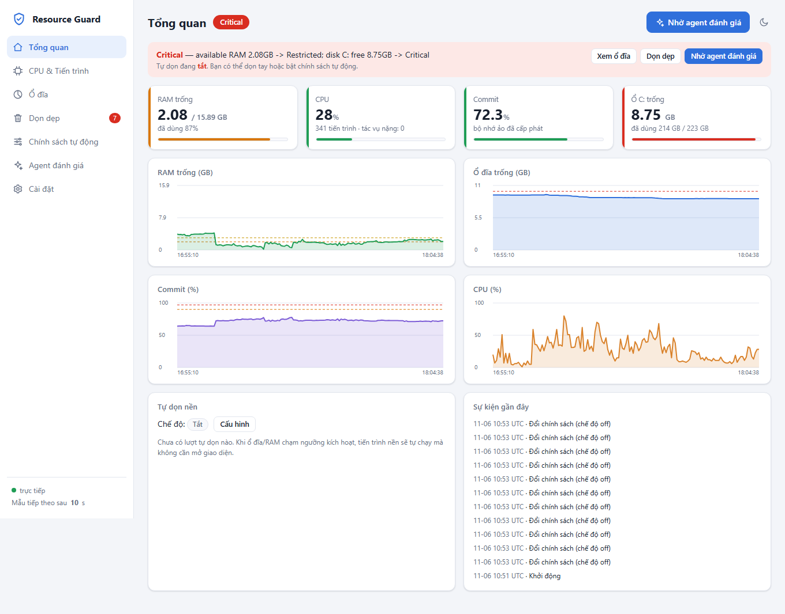
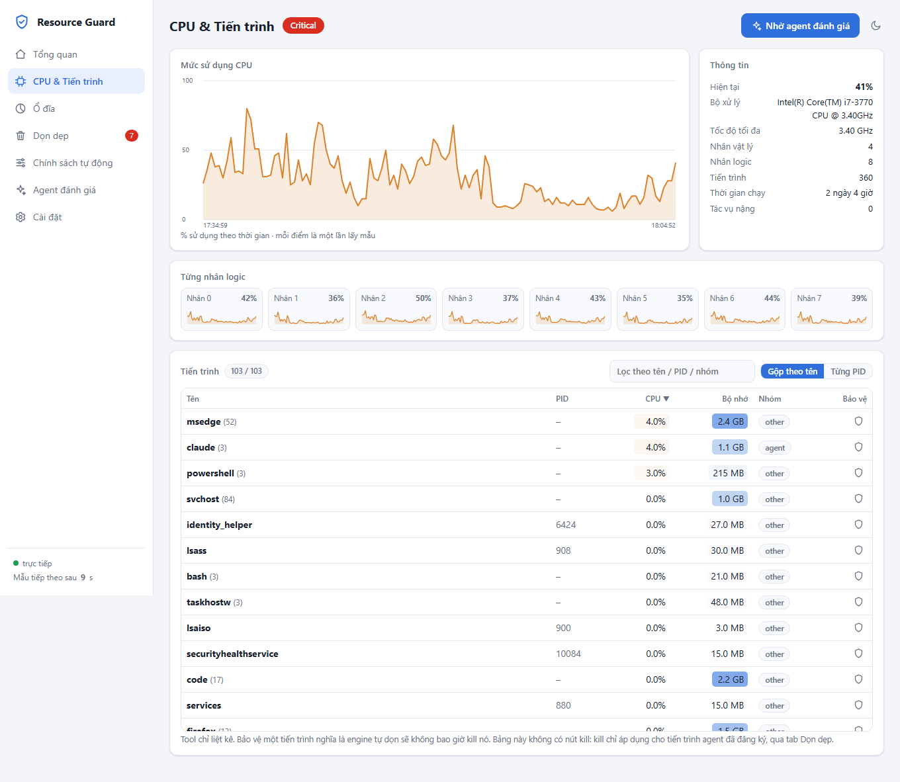
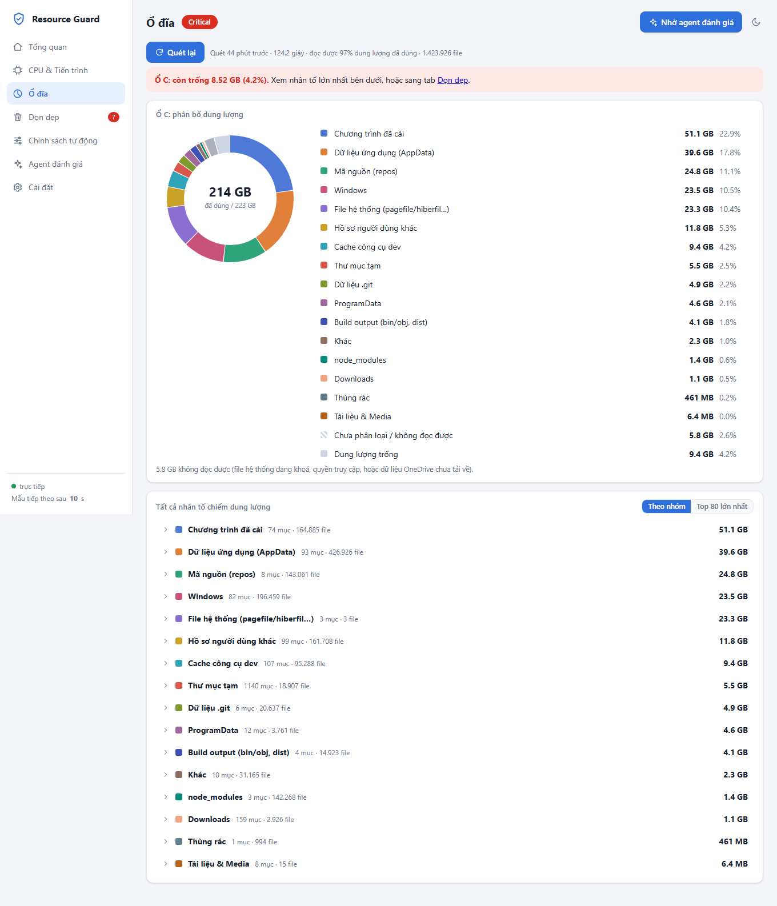
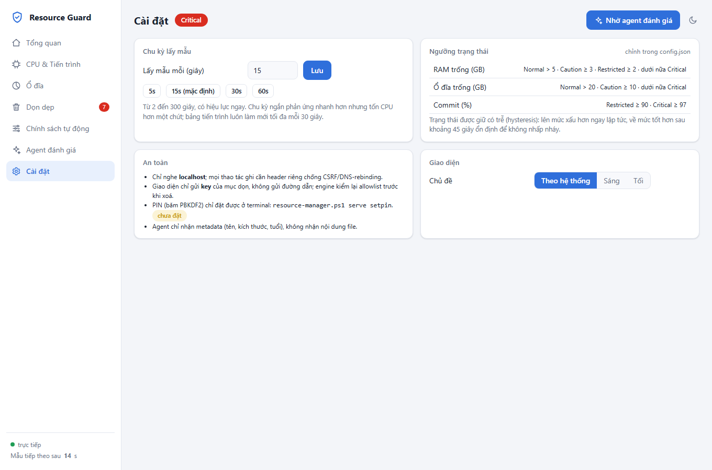

<div align="center">

# 🛡️ Resource Guard

**Giám sát RAM, CPU, ổ đĩa theo thời gian thực và dọn dẹp máy dev Windows một cách an toàn — con người luôn là bên quyết định.**

[](#yêu-cầu)
[](#yêu-cầu)
[](#kiểm-thử)
[](#điểm-nổi-bật)
[](LICENSE)

</div>

<p align="center">
  
</p>

---

## Giới thiệu

Máy dev Windows cạn ổ đĩa và RAM rất nhanh: `bin/obj`, `node_modules`, cache NuGet/npm, thư mục `%TEMP%`, repo cũ, các tiến trình build/test bị bỏ lại… Dọn bằng tay thì tốn thời gian, còn dọn bằng script "xoá hết" thì rủi ro mất dữ liệu.

**Resource Guard** là một lớp quản lý tài nguyên viết hoàn toàn bằng PowerShell, hoạt động theo nguyên tắc:

> **Công cụ nắm toàn bộ dữ kiện và là bên duy nhất được xoá. AI chỉ đánh giá, không có quyền thực thi.**

Mọi thao tác xoá/kết thúc tiến trình đều đi qua một quy trình `plan → approve → apply`, được **kiểm tra lại ngay trước khi thực thi** bởi allowlist, kiểm tra tuổi, junction/symlink và vùng bảo vệ do người dùng đặt.

## Điểm nổi bật

| | |
|---|---|
| 📈 **Realtime** | Dashboard trên `localhost` đẩy dữ liệu bằng Server-Sent Events; RAM, CPU (từng nhân), commit, ổ đĩa, chu kỳ lấy mẫu mặc định 15 giây. |
| 🥧 **Phân tích ổ đĩa** | Biểu đồ tròn theo nhóm (chương trình, AppData, repo, Windows, cache dev, temp…) và liệt kê đầy đủ từng nhân tố chiếm dung lượng. |
| 🧹 **Dọn dẹp có kiểm soát** | File tạm, `bin/obj`, `node_modules`, cache dev, repo cũ đã đồng bộ remote, mục lớn lâu không đụng, tiến trình mồ côi của agent. |
| 🤖 **Tự động hoá theo chính sách** | Chế độ Tắt / Chạy thử / Bật; ngưỡng kích hoạt, cooldown, giới hạn GB mỗi lượt, thứ tự ưu tiên, vùng bảo vệ. |
| 🧠 **Agent đánh giá (tuỳ chọn)** | `claude -p --model haiku --effort high` đọc **metadata** và gợi ý nên dọn/giữ gì; gợi ý chỉ chọn sẵn ô, con người xác nhận. |
| 🗜️ **Nén trước khi xoá** | Repo cũ và mục lớn có thể được nén zip, xác minh từng file rồi mới xoá bản gốc; có nút giải nén về chỗ cũ. |
| 🔒 **Bảo mật theo thiết kế** | Chỉ nghe `localhost`, chống DNS-rebinding/CSRF, PIN dạng PBKDF2, xoá bằng quyền admin chỉ qua UAC và tự kiểm lại độc lập. |
| 📦 **Không phụ thuộc** | Chỉ PowerShell + HTML/JS thuần (SVG), không cần cài module, không cần mạng, không gọi LLM khi chạy lõi. |

## Ảnh chụp màn hình

<table>
  <tr>
    <td width="50%"><br><sub><b>CPU & Tiến trình</b> — đồ thị CPU, từng nhân logic, bảng tiến trình gộp theo tên/PID.</sub></td>
    <td width="50%"><br><sub><b>Ổ đĩa</b> — biểu đồ tròn theo nhóm và danh sách nhân tố.</sub></td>
  </tr>
  <tr>
    <td colspan="2"><br><sub><b>Cài đặt</b> — chu kỳ lấy mẫu, ngưỡng trạng thái, giao diện sáng/tối.</sub></td>
  </tr>
</table>

## Yêu cầu

- Windows 10/11
- Windows PowerShell 5.1 **hoặc** PowerShell 7+
- (Tuỳ chọn) [Claude Code CLI](https://claude.com/claude-code) trong `PATH` để dùng tính năng *Agent đánh giá*

## Bắt đầu nhanh

```powershell
git clone https://github.com/huetruong100802/Resource-Guard.git
cd Resource-Guard

$rm = ".\scripts\resource-manager.ps1"
& $rm serve          # in URL http://localhost:8765/ và mở trình duyệt; Ctrl+C để dừng
```

Chạy ngầm, tự khởi động cùng Windows:

```powershell
& $rm serve -Detach              # chạy ẩn, in URL rồi trả terminal
& $rm serve stop                 # dừng bản chạy ngầm
& $rm serve setpin               # đặt PIN (chỉ ở console tương tác) cho chế độ tự dọn "Bật"
.\scripts\Install-Watcher.ps1    # tự chạy ngầm mỗi lần đăng nhập; thêm -Uninstall để gỡ
```

Trạng thái được lưu tại `%AGENT_RESOURCE_HOME%` (mặc định `~/.agent-resource`).

## Dòng lệnh

```powershell
& $rm status                              # Normal / Caution / Restricted / Critical + lý do
& $rm processes -Top 15                   # nhóm tiến trình, cờ Agent, OrphanCandidate
& $rm preflight build                     # build|test|subagent|session; exit code 2 = từ chối
& $rm register -ProcessId 1234 -Agent claude -Label "dotnet test"   # ghi vào ledger (PID + start time)
& $rm disk scan                           # ứng viên dọn + dung lượng, chỉ đọc
& $rm cleanup plan                        # tạo plan (không xoá gì)
& $rm cleanup approve <PLAN_ID> -All      # NGƯỜI duyệt ở console tương tác, gõ lại plan id
& $rm cleanup apply <PLAN_ID> [-DryRun]   # chỉ chạy các mục đã duyệt
```

Thêm `-Json` vào lệnh để lấy đầu ra máy-đọc. Các script lẻ (`Test-ResourceBudget.ps1`, `New-CleanupPlan.ps1`, …) dùng chung thư viện `rg-common.ps1`.

## Các tab giao diện

| Tab | Chức năng |
|---|---|
| **Tổng quan** | Thẻ RAM/CPU/commit/ổ đĩa theo ngưỡng, 4 biểu đồ realtime, trạng thái tự dọn, sự kiện gần đây. |
| **CPU & Tiến trình** | Kiểu Task Manager: đồ thị CPU, từng nhân logic, bảng tiến trình (gộp theo tên/từng PID, sắp xếp, lọc) và nút khiên để bảo vệ tiến trình khỏi tự dọn. |
| **Ổ đĩa** | Biểu đồ tròn theo nhóm + liệt kê đầy đủ nhân tố (hoặc top 80). Quét ~1–2 phút ở process riêng, chỉ đọc. |
| **Dọn dẹp** | Ứng viên dọn → tick chọn → xác nhận → `plan → approve → apply`. UI chỉ gửi *key*, không bao giờ gửi đường dẫn. |
| **Chính sách tự động** | Tắt / Chạy thử / Bật; mỗi nhóm *Tự động / Hỏi tay / Luôn giữ*; thứ tự ưu tiên; vùng bảo vệ (thư mục + tên tiến trình). |
| **Agent đánh giá** | Xem trước chính xác dữ liệu sẽ gửi, nhận tóm tắt, phát hiện, gợi ý theo ưu tiên và gợi ý chính sách. |
| **Cài đặt** | Chu kỳ lấy mẫu (2–300 giây), ngưỡng, giao diện sáng/tối/theo hệ thống. |

<details>
<summary><b>Các loại ứng viên dọn dẹp</b></summary>

- **File tạm / `bin/obj` / `node_modules` / cache dev** (NuGet, npm, pnpm, Yarn, pip): chỉ mục đủ tuổi và không còn được dùng.
- **Repo cũ** (`stale-repo`): repo git không sửa file nguồn ≥ 90 ngày. Chỉ đề xuất **xoá** khi mọi thứ đã có trên remote (không thay đổi chưa commit, không stash, không commit chưa push); ngược lại chỉ báo cáo kèm lý do. Không bao giờ đề xuất repo chứa chính công cụ này.
- **Mục lớn** (`large-item`): file/thư mục ≥ 500 MB trong `Downloads`, `Videos` không đụng ≥ 60 ngày (đổi ở `cleanup.largeItem`).
- **Ứng dụng** (`app`): thư mục cài đặt lớn, lâu không ghi file. **Chỉ báo cáo**; gỡ bằng *Cài đặt > Ứng dụng*.
- **Cần quyền admin**: thư mục temp cũ do SYSTEM tạo (tên GUID). Nút *Dọn bằng quyền admin…* → hộp xác nhận → UAC → một tiến trình admin riêng tự kiểm lại độc lập từng mục (chỉ thư mục GUID trực tiếp dưới `%TEMP%`, đủ 14 ngày, không junction, không vùng bảo vệ) rồi xoá và thoát. Từ chối UAC thì không xoá gì.
- **Tiến trình mồ côi của agent**: chỉ kill tiến trình đã đăng ký trong ledger, thuộc nhóm build/test/dev.

</details>

<details>
<summary><b>Nén zip trước khi xoá</b></summary>

Với repo cũ và mục lớn, hộp xác nhận có ô *Nén zip cạnh mục* (mặc định bật). Công cụ tạo `<tên>.zip` cạnh vị trí cũ, mở lại để kiểm tra từng file (có mặt, đúng kích thước, đọc giải nén được), kiểm tra nguồn không đổi trong lúc nén, rồi mới xoá bản gốc. Gặp junction, file đang bị khoá, thiếu chỗ trống hoặc lỗi bất kỳ thì **giữ nguyên bản gốc**. Bảng *Bản nén đã tạo* có nút **Giải nén về chỗ cũ** (không ghi đè, chống zip-slip).

</details>

## Chính sách tự động

Mặc định chế độ tự động là **Tắt**. Khi `serve` đang chạy và có áp lực tài nguyên, tiến trình nền `rg-auto.ps1` tự dọn mà không cần mở UI.

| Chế độ | Hành vi |
|---|---|
| **Tắt** | Không làm gì; bạn dọn tay ở tab *Dọn dẹp*. |
| **Chạy thử** | Ghi nhận engine *sẽ* chọn gì, không xoá gì. |
| **Bật** | Xoá thật theo chính sách. Cần PIN để bật hoặc nới lỏng; siết thêm bảo vệ thì không cần PIN. |

Các tham số: ngưỡng kích hoạt (ổ đĩa → dọn file, RAM → kết thúc tiến trình agent), thời gian nghỉ giữa hai lượt, tối đa GB mỗi lượt, ngưỡng dừng, số tiến trình tối đa mỗi lượt. Chính sách nằm ở `state\policy.json`, kết quả lượt gần nhất ở `state\auto-last.json`.

## Agent đánh giá

- Gọi `claude -p --model haiku --effort high`, chi phí thực tế khoảng **$0.006 / lần**.
- Agent chỉ nhận **metadata**: tên thư mục, kích thước, số ngày không dùng, số liệu RAM/CPU/ổ đĩa, tên tiến trình, tóm tắt chính sách. **Không gửi nội dung file**; đường dẫn đã thay tên tài khoản bằng `~`.
- Có nút *Xem trước dữ liệu sẽ gửi* để kiểm tra chính xác payload.
- Kết quả là JSON có cấu trúc; key do agent bịa ra bị loại. Gợi ý chỉ **chọn sẵn ô**, con người quyết định.

## Kiến trúc

```
resource-manager.ps1 serve
        │ (tiến trình nền, mutex Local\ResourceGuardWatcher)
        ▼
rg-server.ps1  ── vòng lặp đơn luồng: lấy mẫu → ghi state\live.json → phát SSE
   │  HttpListener localhost, REST + Server-Sent Events
   ├─ Start-RgJob ──► tiến trình ẩn riêng (không chặn watcher)
   │      rg-scan.ps1     quét đĩa / ứng viên dọn
   │      rg-cleanup.ps1  dọn mục người dùng tick
   │      rg-auto.ps1     một lượt dọn tự động theo chính sách
   │      rg-agent.ps1    gọi claude để đánh giá
   └─ ui\*  (vanilla JS, SVG, không phụ thuộc thư viện ngoài)
```

Quét đĩa mất 1–2 phút và agent mất ~40 giây, nên các job chạy ở process riêng và ghi tiến độ vào `state\<job>.progress.json` để UI không bị đứng và SSE không bị ngắt.

<details>
<summary><b>Cấu trúc thư mục</b></summary>

```
resource-guard/
├── config.default.json     # ngưỡng RAM/đĩa, nhóm tiến trình, đường dẫn cache, vùng bảo vệ
├── scripts/
│   ├── resource-manager.ps1   # điểm vào CLI
│   ├── rg-common.ps1          # log, ghi file atomic, allowlist xoá, plan/approve/apply
│   ├── rg-policy.ps1          # chính sách, PIN, engine tự động
│   ├── rg-server.ps1          # HTTP + SSE, router
│   ├── rg-watcher.ps1         # vòng lấy mẫu, hysteresis, toast
│   ├── rg-scan.ps1            # quét đĩa và ứng viên dọn
│   ├── rg-cleanup.ps1         # dọn mục người dùng chọn (theo key)
│   ├── rg-auto.ps1            # lượt dọn tự động
│   ├── rg-agent.ps1           # dựng payload, gọi claude, lọc kết quả
│   ├── rg-elevate.ps1 / rg-elevated-clean.ps1   # dọn bằng quyền admin (UAC)
│   ├── rg-restore.ps1         # giải nén bản zip về chỗ cũ
│   └── Install-Watcher.ps1    # tự chạy khi đăng nhập
├── ui/                     # dashboard (HTML/CSS/JS thuần)
├── tests/Acceptance.ps1    # bộ test nghiệm thu
└── docs/                   # tài liệu kỹ thuật
```

</details>

## Cấu hình

Muốn đổi ngưỡng hoặc thư mục gốc, sao chép `config.default.json` thành `%AGENT_RESOURCE_HOME%\config.json` rồi chỉnh. Một số khoá chính:

| Khoá | Ý nghĩa |
|---|---|
| `ram`, `disk`, `commit` | Ngưỡng chuyển trạng thái Normal / Caution / Restricted / Critical |
| `policy` | Quy tắc cho từng trạng thái (heavy task, subagent, cleanup) |
| `groups`, `heavy`, `agentCmdRegex` | Cách phân loại tiến trình và nhận diện agent |
| `cleanup.workspaceRoots` | Thư mục gốc chứa repo/dự án được phép quét |
| `cleanup.cacheDirs` | Đường dẫn cache dev (NuGet, npm, pnpm, Yarn, pip) |
| `cleanup.staleRepo`, `largeItem`, `apps` | Ngưỡng cho repo cũ, mục lớn, ứng dụng |
| `protected.segments` | Các segment đường dẫn không bao giờ bị xoá (`.git`, `.ssh`, `Documents`…) |

## An toàn

**Bất biến** (đều có test trong `tests\Acceptance.ps1`):

- `apply` chỉ chạy mục đã duyệt; plan bị sửa sau khi duyệt (hash lệch) bị từ chối.
- Mỗi mục được **kiểm tra lại ngay trước khi thực thi**:
  - *kill*: PID + start time + tên phải khớp, thuộc nhóm build/test/dev và có trong ledger;
  - *xoá*: allowlist theo `kind` + `workspaceRoots`, không junction/symlink, không có segment `.git/.claude/.codex/.ssh/…`, đủ tuổi; mục do tài khoản khác (SYSTEM) sở hữu bị chặn ở đường xoá thường;
  - *repo cũ*: kiểm lại trạng thái git ngay trước khi xoá; không xác minh được thì không xoá.
- Không kill agent/infra/system. VHDX của WSL/Docker chỉ báo cáo. Tiến trình không có trong ledger chỉ được báo cáo, không bao giờ kill.
- **Vùng bảo vệ thắng mọi thứ**: engine tự dọn và cả thao tác chọn tay đều bỏ qua mục nằm trong (hoặc chứa) thư mục bảo vệ / tiến trình khớp tên.
- Mọi thao tác ghi vào `logs\rg-YYYYMMDD.jsonl`; lỗi (ví dụ file bị khoá) ghi rõ nguyên nhân.

**Bảo vệ giao diện và tiến trình:**

- Chỉ nghe `localhost`/`127.0.0.1`, từ chối `Host` lạ, POST cần header `X-RG-Client` (chống DNS-rebinding/CSRF). Cổng bận thì thử cổng kế tiếp.
- PIN lưu dạng PBKDF2 (muối + 120k vòng), sai 5 lần khoá 5 phút.
- Chỉ **một** watcher chạy cùng lúc (mutex). `state\status.html` vẫn được ghi mỗi chu kỳ làm bản dự phòng.
- Metrics lưu ở `state\metrics-*.jsonl`, giữ 14 ngày.

> ⚠️ Xoá là **vĩnh viễn**, không qua Thùng rác. Hãy bắt đầu với chế độ *Chạy thử* để xem engine sẽ chọn gì.

## Kiểm thử

Bộ test nghiệm thu chạy trong sandbox ở `%TEMP%`, không đụng dữ liệu thật:

```powershell
pwsh -NoProfile -File tests\Acceptance.ps1            # PowerShell 7+
powershell.exe -NoProfile -File tests\Acceptance.ps1  # Windows PowerShell 5.1
```

Kết quả hiện tại: **132 pass, 0 fail**.

## Giới hạn đã biết

- "Người duyệt" được thực thi bằng việc yêu cầu console tương tác. Đó là rào chắn thực dụng, **không phải ranh giới bảo mật**: agent chạy cùng user vẫn có thể sửa file plan. Ở P2 nên thêm deny rule/hook chặn lệnh `cleanup approve` từ agent.
- Chưa có hook Claude/Codex (P2). `Test-ResourceBudget.ps1` hiện chỉ trả JSON + exit code; cần map theo giao thức hook của từng CLI và kiểm thử trước khi bật chặn.
- Giới hạn subagent mới theo state, chưa đếm subagent đang chạy (cần SubagentStart/Stop hook).
- Phân loại tiến trình và "heavy task" dựa trên tên + regex command line (xem `config.default.json`), cần hiệu chỉnh theo máy thật.
- Quét đĩa dùng PowerShell + C# đa luồng, chưa thay được các công cụ chuyên dụng như WizTree.

## Tài liệu

- [`docs/TECHNOTE.md`](docs/TECHNOTE.md) — kiến trúc chi tiết, chính sách, API, các bẫy đã gặp khi sửa code.

## Giấy phép

Phát hành theo giấy phép [MIT](LICENSE).
