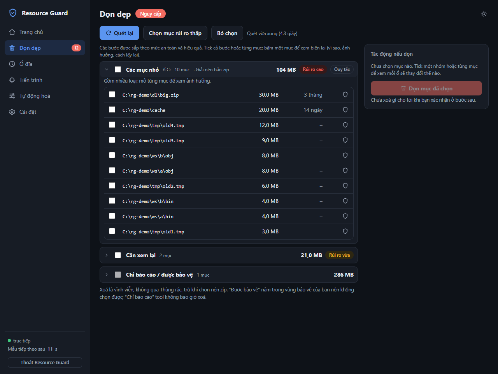
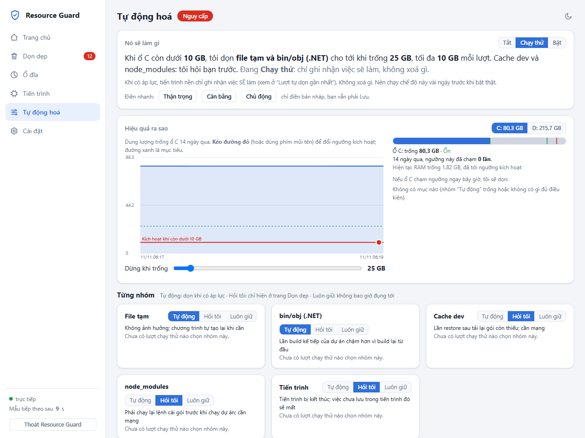

<div align="center">

# 🛡️ Resource Guard

**Giám sát RAM, CPU, ổ đĩa theo thời gian thực và dọn dẹp máy dev Windows một cách an toàn — con người luôn là bên quyết định.**

[](#yêu-cầu)
[](#yêu-cầu)
[](#kiểm-thử)
[](#điểm-nổi-bật)
[](LICENSE)

</div>

<p align="center">
  
</p>

---

## Giới thiệu

Máy dev Windows cạn ổ đĩa và RAM rất nhanh: `bin/obj`, `node_modules`, cache NuGet/npm, thư mục `%TEMP%`, repo cũ, các tiến trình build/test bị bỏ lại… Dọn bằng tay thì tốn thời gian, còn dọn bằng script "xoá hết" thì rủi ro mất dữ liệu.

**Resource Guard** là một lớp quản lý tài nguyên viết hoàn toàn bằng PowerShell, hoạt động theo nguyên tắc:

> **Công cụ nắm toàn bộ dữ kiện và là bên duy nhất được xoá. AI chỉ đánh giá, không có quyền thực thi.**

Mọi thao tác xoá/kết thúc tiến trình đều đi qua một quy trình `plan → approve → apply`, được **kiểm tra lại ngay trước khi thực thi** bởi allowlist, kiểm tra tuổi, junction/symlink và vùng bảo vệ do người dùng đặt.

## Điểm nổi bật

| | |
|---|---|
| 📈 **Realtime** | Dashboard trên `localhost` đẩy dữ liệu bằng Server-Sent Events; RAM, CPU (từng nhân), commit, ổ đĩa, chu kỳ lấy mẫu mặc định 15 giây. |
| 🏠 **Biết ngay nên làm gì** | Trang chủ trả lời bằng một câu: máy có đủ chỗ để build/test/chạy agent không, ổ nào sắp đầy (dự báo ngày đầy), và **kế hoạch đề xuất** dọn gì trước, được bao nhiêu. |
| 📊 **Thấy trước ảnh hưởng** | Thanh “trước → sau” cho từng ổ, cập nhật tức thì khi tick/bỏ tick; kéo ngưỡng tự động hoá là câu mô tả, số lần chạm và danh sách mục đổi theo; hạ ưu tiên tiến trình có nút hoàn tác. |
| 🥧 **Phân tích ổ đĩa** | Treemap đào sâu (chuột/bàn phím) với lớp phủ: mục dọn được, đang chọn, được bảo vệ, vùng cố định. **Quét nhanh** chỉ quét phần dọn được; **quét đầy đủ** quét hết. Chạy nền, kết quả hiện dần. |
| 🧹 **Dọn dẹp có kiểm soát** | File tạm, `bin/obj`, `node_modules`, cache dev, repo cũ đã đồng bộ remote, mục lớn lâu không đụng, tiến trình mồ côi của agent. |
| 🤖 **Tự động hoá theo chính sách** | Chế độ Tắt / Chạy thử / Bật; ngưỡng kích hoạt, cooldown, giới hạn GB mỗi lượt, thứ tự ưu tiên, vùng bảo vệ. |
| 🧠 **Agent đánh giá (tuỳ chọn)** | `claude -p --model haiku --effort high` đọc **metadata** và gợi ý nên dọn/giữ gì; “nên dọn” chỉ chọn sẵn ô, con người xác nhận; “nên giữ” (tin cậy cao) tự bảo vệ có thời hạn. |
| 🗜️ **Nén trước khi xoá** | Repo cũ và mục lớn có thể được nén zip, xác minh từng file rồi mới xoá bản gốc; có nút giải nén về chỗ cũ. |
| 🔒 **Bảo mật theo thiết kế** | Chỉ nghe `localhost`, chống DNS-rebinding/CSRF, PIN dạng PBKDF2, xoá bằng quyền admin chỉ qua UAC và tự kiểm lại độc lập. |
| 📦 **Không phụ thuộc** | Chỉ PowerShell + HTML/JS thuần (SVG), không cần cài module, không cần mạng, không gọi LLM khi chạy lõi. |

## Ảnh chụp màn hình

<table>
  <tr>
    <td width="50%"><br><sub><b>Dọn dẹp</b> — mục dọn được xếp theo bước an toàn; ô bên phải cho thấy tác động trước khi xác nhận.</sub></td>
    <td width="50%"><br><sub><b>Ổ đĩa</b> — phân bố theo nhóm và treemap thư mục (bấm đúp để đào sâu).</sub></td>
  </tr>
  <tr>
    <td width="50%"><br><sub><b>Tiến trình</b> — ai đang chiếm RAM theo thời gian, đồ thị CPU, bảng tiến trình gộp theo tên/PID.</sub></td>
    <td width="50%"><br><sub><b>Tự động hoá</b> — câu mô tả việc sẽ làm, kéo ngưỡng kích hoạt, chọn Tắt / Chạy thử / Bật theo từng nhóm.</sub></td>
  </tr>
  <tr>
    <td colspan="2"><br><sub><b>Cài đặt</b> — chu kỳ lấy mẫu, ngưỡng trạng thái, khởi động cùng Windows, giao diện sáng/tối.</sub></td>
  </tr>
</table>

> Ảnh chụp từ bản chạy thật trên dữ liệu giả (thư mục demo), nên đường dẫn và dung lượng dọn được chỉ mang tính minh hoạ.

## Yêu cầu

- Windows 10/11
- Windows PowerShell 5.1 **hoặc** PowerShell 7+
- (Tuỳ chọn) [Claude Code CLI](https://claude.com/claude-code) trong `PATH` để dùng tính năng *Agent đánh giá*

## Bắt đầu nhanh

```powershell
git clone https://github.com/huetruong100802/Resource-Guard.git
cd Resource-Guard

.\rg start           # chạy ngầm (nếu chưa chạy) và mở giao diện http://localhost:8765/
.\rg status          # đang chạy hay dừng, URL, tự dọn, tự chạy cùng Windows
.\rg stop            # dừng êm (hoặc bấm "Thoát Resource Guard" ở góc dưới thanh bên của giao diện)
```

Dùng hằng ngày, một lần cho mỗi máy:

```powershell
.\rg shortcut        # lối tắt "Resource Guard" ở Start Menu: bấm là chạy ngầm + mở giao diện (thêm -Desktop để có ở màn hình nền)
.\rg autostart on    # tự chạy ngầm mỗi lần đăng nhập Windows (off để tắt)
.\rg path            # thêm thư mục này vào PATH người dùng để gõ "rg ..." ở bất kỳ đâu (mở terminal mới sau khi thêm)
.\rg pin             # đặt PIN (chỉ ở console tương tác) cho chế độ tự dọn "Bật"
.\rg run             # chạy ngay trong cửa sổ này (Ctrl+C để dừng), không chạy ngầm
```

`rg stop` dừng êm: đóng cổng, nhả khoá, huỷ lượt quét ổ/agent đang chạy. Nếu đang có lượt **dọn/khôi phục/tự dọn** chưa xong, app từ chối thoát để không bỏ dở thao tác xoá (`rg stop -Force` mới buộc dừng). Lưu ý **tự dọn nền chỉ hoạt động khi app đang chạy**. Các lệnh cũ `resource-manager.ps1 serve ...` vẫn dùng được.

Trạng thái được lưu tại `%AGENT_RESOURCE_HOME%` (mặc định `~/.agent-resource`).

## Dòng lệnh

```powershell
& $rm status                              # Normal / Caution / Restricted / Critical + lý do
& $rm processes -Top 15                   # nhóm tiến trình, cờ Agent, OrphanCandidate
& $rm preflight build                     # build|test|subagent|session; exit code 2 = từ chối
& $rm register -ProcessId 1234 -Agent claude -Label "dotnet test"   # ghi vào ledger (PID + start time)
& $rm disk scan                           # ứng viên dọn + dung lượng, chỉ đọc
& $rm cleanup plan                        # tạo plan (không xoá gì)
& $rm cleanup approve <PLAN_ID> -All      # NGƯỜI duyệt ở console tương tác, gõ lại plan id
& $rm cleanup apply <PLAN_ID> [-DryRun]   # chỉ chạy các mục đã duyệt
```

Thêm `-Json` vào lệnh để lấy đầu ra máy-đọc. Các script lẻ (`Test-ResourceBudget.ps1`, `New-CleanupPlan.ps1`, …) dùng chung thư viện `rg-common.ps1`.

## Các tab giao diện

| Tab | Chức năng |
|---|---|
| **Trang chủ** | Một câu trạng thái; “Sẵn sàng cho” build/test/agent (thiếu bao nhiêu GB); mỗi ổ một thanh tác động + dự báo ngày đầy; **kế hoạch đề xuất** theo bước (rê vào bước thì thanh ảnh hưởng đổi); biểu đồ “Resource Guard đã làm gì” với điểm đánh dấu bấm được để mở *biên lai*; nút **Hỏi trợ lý** (ngăn kéo, ẩn nếu không có `claude` trong PATH). |
| **Dọn dẹp** | Các bước của kế hoạch dưới dạng nhóm mở được; tick cả nhóm hoặc từng mục; thanh ảnh hưởng `trước → sau` đổi tức thì; hộp xác nhận cho thấy cả hành động lẫn ảnh hưởng; sau khi dọn có **dự kiến / thực tế**. UI chỉ gửi *key*, không bao giờ gửi đường dẫn. Vẫn có khối Bản nén đã tạo, Cần quyền admin, Agent đang giữ. |
| **Ổ đĩa** | Thanh phân bố theo nhóm (hiện dần khi đang quét), **treemap** đào sâu bằng chuột hoặc Enter (Esc/Backspace để lùi), tab *Top lớn nhất*, ngăn kéo cho từng thư mục (bảo vệ thư mục, chọn mục dọn). **Quét nhanh** / **Quét đầy đủ**. |
| **Tiến trình** | Biểu đồ RAM xếp chồng theo tiến trình, CPU kèm điểm đánh dấu khi hạ ưu tiên, bảng tiến trình. Ngăn kéo từng tiến trình: lịch sử, “nếu đóng ứng dụng này sẽ giải phóng bao nhiêu” (ước tính), **hạ ưu tiên / hoàn tác**, bảo vệ. Không có nút kết thúc tiến trình. |
| **Tự động hoá** | Một câu mô tả chính sách; **kéo vạch ngưỡng** trên biểu đồ ổ (hoặc dùng phím mũi tên) để đổi; xem trước (số lần chạm trong 14 ngày, mục sẽ bị chọn) trước khi Lưu; 3 mức điền sẵn; mục Nâng cao (ngưỡng RAM, thứ tự, vùng bảo vệ) thu gọn. Lưu khi *Bật* hoặc nới lỏng vẫn cần PIN. |
| **Cài đặt** | Chu kỳ lấy mẫu (2–300 giây), ngưỡng, giao diện sáng/tối/theo hệ thống, công tắc **chạy cùng Windows** và **lối tắt Start Menu**. |

Lần đầu mở, một hộp 3 bước giới thiệu app, bật chạy cùng Windows/lối tắt và chọn chế độ tự động (mặc định **Chạy thử**). Có thể bỏ qua; mọi thứ đổi lại được ở Cài đặt và Tự động hoá. Đặt PIN vẫn chỉ ở console (`rg pin`).

<details>
<summary><b>Các loại ứng viên dọn dẹp</b></summary>

- **File tạm / `bin/obj` / `node_modules` / cache dev** (NuGet, npm, pnpm, Yarn, pip): mục đủ tuổi và không còn được dùng là ứng viên thường. Mục **chưa đủ tuổi** nhưng đủ lớn (`cleanup.youngMinMB`, mặc định 100 MB; số âm = tắt) vẫn được đưa vào danh sách với nhãn *chưa đủ tuổi* (kèm tuổi thật) để agent đánh giá: tuổi chỉ là một tín hiệu. Mục này **không bao giờ tự dọn** (auto-clean bỏ qua, apply chặn nếu plan do policy tự duyệt); chỉ xoá khi người dùng duyệt. Với cache có thêm mục "toàn bộ cache" (gồm cả file mới dùng). `stale-repo`/`large-item` không có chế độ này.
- **Repo cũ** (`stale-repo`): repo git không sửa file nguồn ≥ 90 ngày. Chỉ đề xuất **xoá** khi mọi thứ đã có trên remote (không thay đổi chưa commit, không stash, không commit chưa push); ngược lại chỉ báo cáo kèm lý do. Không bao giờ đề xuất repo chứa chính công cụ này.
- **Mục lớn** (`large-item`): file/thư mục ≥ 500 MB trong `Downloads`, `Videos` không đụng ≥ 60 ngày (đổi ở `cleanup.largeItem`).
- **Ứng dụng** (`app`): thư mục cài đặt lớn, lâu không ghi file. **Chỉ báo cáo**; gỡ bằng *Cài đặt > Ứng dụng*.
- **Cần quyền admin**: thư mục temp cũ do SYSTEM tạo (tên GUID). Nút *Dọn bằng quyền admin…* → hộp xác nhận → UAC → một tiến trình admin riêng tự kiểm lại độc lập từng mục (chỉ thư mục GUID trực tiếp dưới `%TEMP%`, đủ 14 ngày, không junction, không vùng bảo vệ) rồi xoá và thoát. Từ chối UAC thì không xoá gì.
- **Tiến trình mồ côi của agent**: chỉ kill tiến trình đã đăng ký trong ledger, thuộc nhóm build/test/dev.

</details>

<details>
<summary><b>Nén zip trước khi xoá</b></summary>

Với repo cũ và mục lớn, hộp xác nhận có ô *Nén zip cạnh mục* (mặc định bật). Công cụ tạo `<tên>.zip` cạnh vị trí cũ, mở lại để kiểm tra từng file (có mặt, đúng kích thước, đọc giải nén được), kiểm tra nguồn không đổi trong lúc nén, rồi mới xoá bản gốc. Gặp junction, file đang bị khoá, thiếu chỗ trống hoặc lỗi bất kỳ thì **giữ nguyên bản gốc**. Bảng *Bản nén đã tạo* có nút **Giải nén về chỗ cũ** (không ghi đè, chống zip-slip).

</details>

## Chính sách tự động

Mặc định chế độ tự động là **Tắt**. Khi `serve` đang chạy và có áp lực tài nguyên, tiến trình nền `rg-auto.ps1` tự dọn mà không cần mở UI.

| Chế độ | Hành vi |
|---|---|
| **Tắt** | Không làm gì; bạn dọn tay ở tab *Dọn dẹp*. |
| **Chạy thử** | Ghi nhận engine *sẽ* chọn gì, không xoá gì. |
| **Bật** | Xoá thật theo chính sách. Cần PIN để bật hoặc nới lỏng; siết thêm bảo vệ thì không cần PIN. |

Các tham số: ngưỡng kích hoạt (ổ đĩa → dọn file, RAM → kết thúc tiến trình agent), thời gian nghỉ giữa hai lượt, tối đa GB mỗi lượt, ngưỡng dừng, số tiến trình tối đa mỗi lượt. Chính sách nằm ở `state\policy.json`, kết quả lượt gần nhất ở `state\auto-last.json`.

### Nhiều ổ đĩa

Tool giám sát mọi ổ **cố định** (Fixed) đã sẵn sàng; ổ USB/mạng/ổ CD bị bỏ qua. Mỗi ổ có trạng thái riêng, trạng thái chung của máy là mức xấu nhất. Tự dọn đánh giá **từng ổ**: ổ nào chạm ngưỡng thì chỉ chọn mục nằm trên ổ đó, dừng khi ổ đó đủ `targetFreeGB`, và giới hạn `maxGBPerRun` tính riêng cho từng ổ.

- Chính sách: `drives` trong `policy.json`, ví dụ `{ "D": { "diskTrigger": "Caution", "targetFreeGB": 60 } }`. Thiếu khoá nào thì dùng giá trị chung. Nới lỏng ghi đè theo ổ cũng cần PIN khi chế độ là *Bật*.
- Ngưỡng cảnh báo: `disk.drives.<X>` trong `config` (ghi đè `normalAboveGB`/`cautionFromGB` cho riêng ổ); `disk.exclude` loại ổ khỏi giám sát.
- Thư mục mã nguồn: ngoài `cleanup.workspaceRoots`, tool tự nhận các thư mục tên `Work`, `Repositories`, `Repos`, `Source`, `Src`, `Projects`, `Dev`, `Code`, `Workspace` ở gốc các ổ không phải ổ hệ thống (`cleanup.autoRootNames` đổi danh sách tên, `cleanup.autoRoots: false` tắt hẳn).
- Kết quả quét ổ lưu ở `state\scan-breakdown-<X>.json` (số theo nhóm), `state\scan-tree-<X>.json` (cây thư mục đã cắt tỉa cho treemap) và `state\scan-fixed-<X>.json` (số của vùng cố định, dùng lại ở *Quét nhanh*).

### Quét ổ đĩa

| Phạm vi | Làm gì |
|---|---|
| **Quét nhanh** (`focus`) | Bỏ qua **vùng cố định** (Windows, Program Files, ProgramData, hồ sơ người dùng khác): không dọn được nên không cần quét lại; số của vùng này lấy từ lượt quét đầy đủ gần nhất (ô được đánh dấu “chưa quét chi tiết”). Chưa có lượt đầy đủ nào thì server tự chạy quét đầy đủ. |
| **Quét đầy đủ** (`full`) | Quét mọi thứ; làm mới số của vùng cố định. |

Bộ quét dùng Win32 `FindFirstFileExW` đa luồng, ưu tiên thấp (BelowNormal). Đo trên máy phát triển (ổ C, ~270 nghìn file): bản cũ 85,7 giây; bản mới **23,8 giây** (đầy đủ), **12,8 giây** (nhanh). Số file/byte của các nhóm không đổi giữa hai lượt quét khớp với bản cũ.

**Tự làm mới nền:** khi máy rảnh (CPU dưới `scan.cpuMaxPct`, mặc định 40%), kết quả quét cũ hơn `scan.autoRefreshHours` (mặc định 6; `0` = tắt) (và không có tác vụ nền nào đang chạy) thì server tự chạy một lượt ở ổ có số liệu cũ nhất, hoặc quét mục có thể dọn nếu nó cũ hơn. Mặc định là quét nhanh; lượt đầy đủ gần nhất cũ hơn 7 ngày thì quét đầy đủ. Hai lượt tự chạy cách nhau ít nhất 10 phút, mỗi lần một việc, ghi `scan-auto` vào log.

## Agent đánh giá

- Gọi `claude -p --model haiku --effort high`, chi phí thực tế khoảng **$0.006 / lần**.
- Agent chỉ nhận **metadata**: tên thư mục, kích thước, số ngày không dùng, số liệu RAM/CPU/ổ đĩa, tên tiến trình, tóm tắt chính sách. **Không gửi nội dung file**; đường dẫn đã thay tên tài khoản bằng `~`.
- Có nút *Xem trước dữ liệu sẽ gửi* để kiểm tra chính xác payload.
- Kết quả là JSON có cấu trúc; key do agent bịa ra bị loại. Verdict **nên dọn** chỉ **chọn sẵn ô**, con người xác nhận mới xoá.
- Trợ lý không còn là tab riêng: nút **Hỏi trợ lý** ở Trang chủ mở ngăn kéo; `#agent` trên URL mở Trang chủ kèm ngăn kéo. Không có `claude` trong PATH thì nút ẩn đi, kế hoạch tất định vẫn đầy đủ. Payload mang cả kế hoạch đề xuất và danh sách “cần xem lại”; agent được yêu cầu đánh giá các mục cần xem lại trước và để phần tóm tắt trả lời “nên làm gì trước”.
- Verdict **nên giữ** với độ tin cậy cao được **tự bảo vệ 30 ngày** (chỉ áp cho thư mục/file, không áp cho tiến trình): mục đó ẩn khỏi danh sách dọn và không bao giờ bị tự dọn. Khối “Agent đang giữ” ở tab Dọn dẹp cho xem lý do, ngày hết hạn và bỏ giữ từng mục. Agent chỉ thêm được bảo vệ, không gỡ được; dữ liệu ở `state\agent-keep.json`.

## Kiến trúc

```
resource-manager.ps1 serve
        │ (tiến trình nền, mutex Local\ResourceGuardWatcher)
        ▼
rg-server.ps1  ── vòng lặp đơn luồng: lấy mẫu → ghi state\live.json → phát SSE
   │  HttpListener localhost, REST + Server-Sent Events
   ├─ Start-RgJob ──► tiến trình ẩn riêng (không chặn watcher)
   │      rg-scan.ps1     quét đĩa / ứng viên dọn
   │      rg-cleanup.ps1  dọn mục người dùng tick
   │      rg-auto.ps1     một lượt dọn tự động theo chính sách
   │      rg-agent.ps1    gọi claude để đánh giá
   └─ ui\*  (vanilla JS, SVG, không phụ thuộc thư viện ngoài)
```

Quét đĩa mất 1–2 phút và agent mất ~40 giây, nên các job chạy ở process riêng và ghi tiến độ vào `state\<job>.progress.json` để UI không bị đứng và SSE không bị ngắt.

<details>
<summary><b>Cấu trúc thư mục</b></summary>

```
resource-guard/
├── config.default.json     # ngưỡng RAM/đĩa, nhóm tiến trình, đường dẫn cache, vùng bảo vệ
├── scripts/
│   ├── resource-manager.ps1   # điểm vào CLI
│   ├── rg-common.ps1          # log, ghi file atomic, allowlist xoá, plan/approve/apply
│   ├── rg-policy.ps1          # chính sách, PIN, engine tự động
│   ├── rg-server.ps1          # HTTP + SSE, router
│   ├── rg-watcher.ps1         # vòng lấy mẫu, hysteresis, toast
│   ├── rg-scan.ps1            # quét đĩa (nhanh/đầy đủ, cây thư mục) và ứng viên dọn
│   ├── rg-insight.ps1         # mức sẵn sàng, dự báo ngày đầy, kế hoạch đề xuất tất định
│   ├── rg-proc.ps1            # hạ/hoàn tác ưu tiên tiến trình, lịch sử theo tiến trình
│   ├── rg-setup.ps1           # chạy cùng Windows, lối tắt, trạng thái lần đầu
│   ├── spikes/usn-probe.ps1   # spike: đọc USN journal không cần admin (xem TECHNOTE)
│   ├── rg-cleanup.ps1         # dọn mục người dùng chọn (theo key)
│   ├── rg-auto.ps1            # lượt dọn tự động
│   ├── rg-agent.ps1           # dựng payload, gọi claude, lọc kết quả
│   ├── rg-elevate.ps1 / rg-elevated-clean.ps1   # dọn bằng quyền admin (UAC)
│   ├── rg-restore.ps1         # giải nén bản zip về chỗ cũ
│   └── Install-Watcher.ps1    # tự chạy khi đăng nhập
├── ui/                     # dashboard (HTML/CSS/JS thuần)
├── tests/Acceptance.ps1    # bộ test nghiệm thu
├── tests/Check-Syntax.ps1  # kiểm cú pháp mọi .ps1 và .js
└── docs/                   # tài liệu kỹ thuật
```

</details>

## Cấu hình

Muốn đổi ngưỡng hoặc thư mục gốc, sao chép `config.default.json` thành `%AGENT_RESOURCE_HOME%\config.json` rồi chỉnh. Một số khoá chính:

| Khoá | Ý nghĩa |
|---|---|
| `ram`, `disk`, `commit` | Ngưỡng chuyển trạng thái Normal / Caution / Restricted / Critical |
| `policy` | Quy tắc cho từng trạng thái (heavy task, subagent, cleanup) |
| `groups`, `heavy`, `agentCmdRegex` | Cách phân loại tiến trình và nhận diện agent |
| `cleanup.workspaceRoots` | Thư mục gốc chứa repo/dự án được phép quét |
| `cleanup.cacheDirs` | Đường dẫn cache dev (NuGet, npm, pnpm, Yarn, pip) |
| `cleanup.staleRepo`, `largeItem`, `apps` | Ngưỡng cho repo cũ, mục lớn, ứng dụng |
| `scan.autoRefreshHours`, `scan.cpuMaxPct` | Tự làm mới kết quả quét ổ khi máy rảnh (giờ; `0` = tắt) và ngưỡng CPU coi là rảnh |
| `protected.segments` | Các segment đường dẫn không bao giờ bị xoá (`.git`, `.ssh`, `Documents`…) |

## An toàn

**Bất biến** (đều có test trong `tests\Acceptance.ps1`):

- `apply` chỉ chạy mục đã duyệt; plan bị sửa sau khi duyệt (hash lệch) bị từ chối.
- Mỗi mục được **kiểm tra lại ngay trước khi thực thi**:
  - *kill*: PID + start time + tên phải khớp, thuộc nhóm build/test/dev và có trong ledger;
  - *xoá*: allowlist theo `kind` + `workspaceRoots`, không junction/symlink, không có segment `.git/.claude/.codex/.ssh/…`, đủ tuổi; mục do tài khoản khác (SYSTEM) sở hữu bị chặn ở đường xoá thường;
  - *repo cũ*: kiểm lại trạng thái git ngay trước khi xoá; không xác minh được thì không xoá.
- Không kill agent/infra/system. VHDX của WSL/Docker chỉ báo cáo. Tiến trình không có trong ledger chỉ được báo cáo, không bao giờ kill.
- **Vùng bảo vệ thắng mọi thứ**: engine tự dọn và cả thao tác chọn tay đều bỏ qua mục nằm trong (hoặc chứa) thư mục bảo vệ / tiến trình khớp tên.
- Mọi thao tác ghi vào `logs\rg-YYYYMMDD.jsonl`; lỗi (ví dụ file bị khoá) ghi rõ nguyên nhân.

**Bảo vệ giao diện và tiến trình:**

- Chỉ nghe `localhost`/`127.0.0.1`, từ chối `Host` lạ, POST cần header `X-RG-Client` (chống DNS-rebinding/CSRF). Cổng bận thì thử cổng kế tiếp.
- PIN lưu dạng PBKDF2 (muối + 120k vòng), sai 5 lần khoá 5 phút.
- Chỉ **một** watcher chạy cùng lúc (mutex). `state\status.html` vẫn được ghi mỗi chu kỳ làm bản dự phòng.
- Metrics lưu ở `state\metrics-*.jsonl`, giữ 14 ngày.

> ⚠️ Xoá là **vĩnh viễn**, không qua Thùng rác. Hãy bắt đầu với chế độ *Chạy thử* để xem engine sẽ chọn gì.

## Kiểm thử

Bộ test nghiệm thu chạy trong sandbox ở `%TEMP%`, không đụng dữ liệu thật:

```powershell
powershell.exe -NoProfile -ExecutionPolicy Bypass -File tests\Acceptance.ps1   # Windows PowerShell 5.1 (có sẵn, không cần cài thêm)
```

Kiểm cú pháp nhanh (mọi `.ps1` và `.js`): `powershell.exe -NoProfile -File tests\Check-Syntax.ps1`.

Kết quả hiện tại trên Windows PowerShell 5.1: **374 pass, 0 fail**. Dự án nhắm tới Windows PowerShell 5.1 (có sẵn trên Windows); PowerShell 7+ (`pwsh`) không bắt buộc và chưa được kiểm.

Đừng chạy test khi một server Resource Guard khác đang chạy: mutex watcher dùng chung toàn máy nên nhóm `[api]` sẽ lỗi.

## Giới hạn đã biết

- "Người duyệt" được thực thi bằng việc yêu cầu console tương tác. Đó là rào chắn thực dụng, **không phải ranh giới bảo mật**: agent chạy cùng user vẫn có thể sửa file plan. Ở P2 nên thêm deny rule/hook chặn lệnh `cleanup approve` từ agent.
- Chưa có hook Claude/Codex (P2). `Test-ResourceBudget.ps1` hiện chỉ trả JSON + exit code; cần map theo giao thức hook của từng CLI và kiểm thử trước khi bật chặn.
- Giới hạn subagent mới theo state, chưa đếm subagent đang chạy (cần SubagentStart/Stop hook).
- Phân loại tiến trình và "heavy task" dựa trên tên + regex command line (xem `config.default.json`), cần hiệu chỉnh theo máy thật.
- Quét đĩa dùng PowerShell + C# đa luồng (`FindFirstFileExW`), chưa thay được các công cụ chuyên dụng như WizTree. Chưa có quét tăng dần bằng USN journal: spike cho thấy ổ C giữ journal chỉ vài giờ nên chưa đáng làm (chi tiết ở TECHNOTE).

## Tài liệu

- [`docs/TECHNOTE.md`](docs/TECHNOTE.md) — kiến trúc chi tiết, chính sách, API, các bẫy đã gặp khi sửa code.

## Giấy phép

Phát hành theo giấy phép [MIT](LICENSE).
